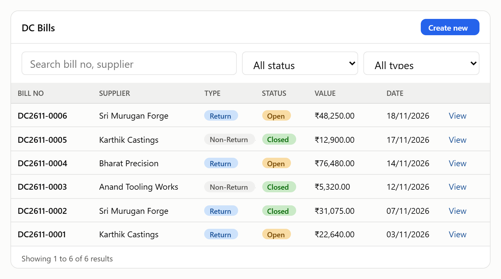
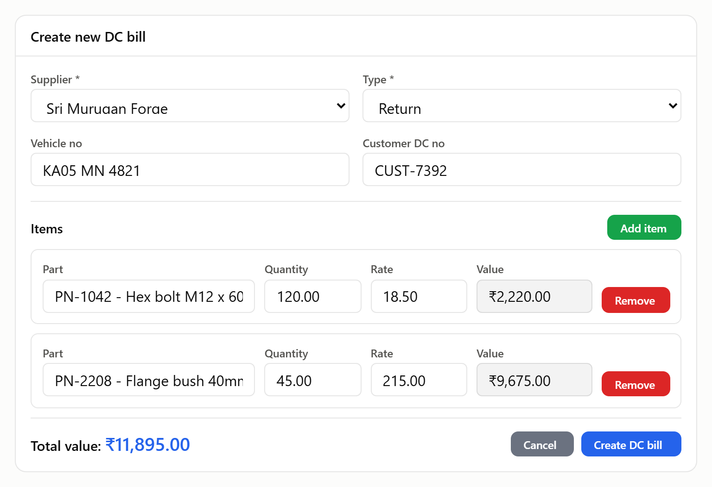
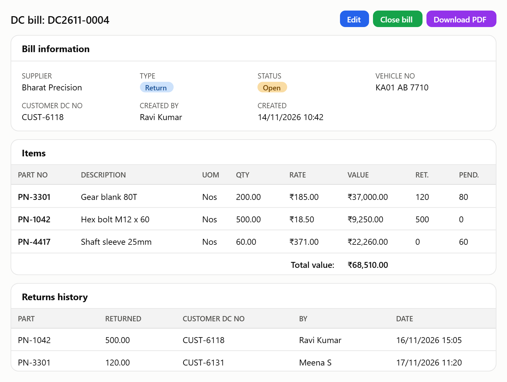
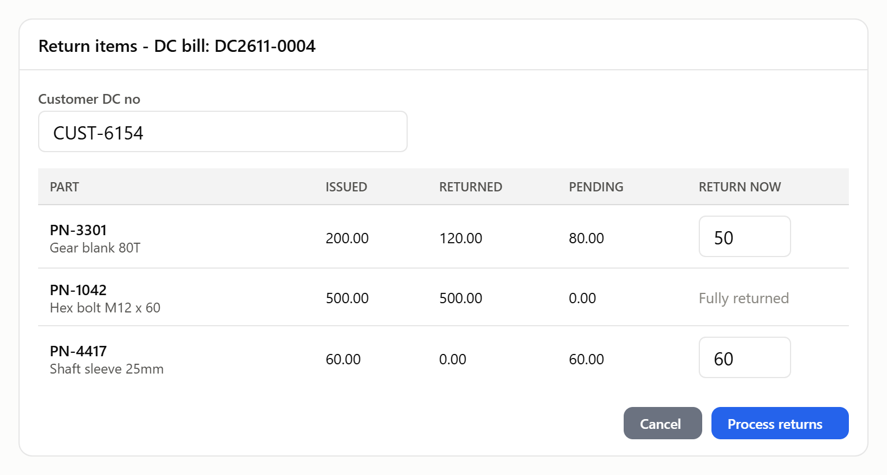

# 📦 DC Bill Management System

A delivery challan (DC) management application built for a mechanical engineering company in Chennai. It tracks parts issued to suppliers, records what comes back, keeps stock up to date and produces printable bills.

> ℹ️ This is a showcase repository. The source code is private; this page describes the features, my role and the tech used. All screenshots use demo data.

---

## 📸 Screenshots

### DC bill list
Search by bill number or supplier, and filter by status (Open / Closed) and type (Return / Non-Return).

### Create a DC bill
Choose the supplier and bill type, add parts with part-number search, and see item values and the bill total update as you type.

### Bill detail & returns history
Issued, returned and pending quantity for each item, plus a full history of who returned what, when, and against which customer DC.

### Process returns
Record partial returns against a bill under a new customer DC number. Fully returned items are locked automatically.

---

## ✨ Features

- **DC bill management:** create, view, edit and delete bills with auto-generated bill numbers
- **Return and Non-Return bills:** Return bills track issued, returned and pending quantities for each item
- **Partial returns:** record multiple returns against one bill, each with its own customer DC number
- **Part autocomplete:** search parts by part number or description while adding items
- **Live totals:** item values and the bill total update as you type
- **Open/Closed workflow:** close a settled bill, or reopen it if needed
- **Stock updates:** returned quantities are added back to part stock
- **PDF export:** printable bill with item table, returns history and signature block
- **Audit trail:** every return records the user, date and customer DC

## 🛠️ Tech Stack

- Laravel with Blade components and authentication
- Tailwind CSS
- MySQL (also runs on MariaDB, PostgreSQL and SQLite)
- DomPDF for printable bills

## 👤 My role

Designed and developed the application end to end for the client: data model, bill and returns workflow, stock updates, PDF output and the user interface.

---

📫 Want to know more? See my [portfolio](https://varunvasudevan.github.io).
